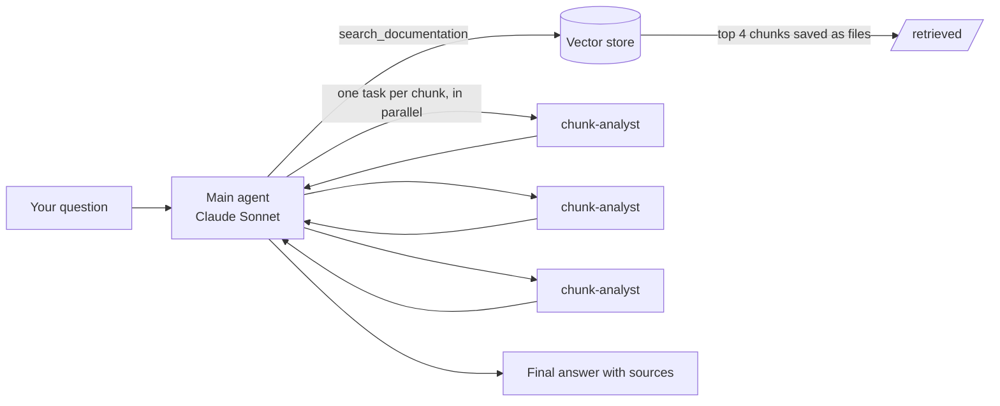

# RAG_LANGCHAIN: Chat With Your Documents

A retrieval-augmented generation (RAG) app that lets you upload PDFs, text or Markdown files and ask questions about them in plain English. Answers are grounded in your documents: the agent **searches before it speaks**, reads the most relevant passages, and cites where each answer came from.

Built with **LangChain**, **Deep Agents**, **Claude Sonnet**, **Voyage AI embeddings** and **Streamlit**.

---

## How it works

The project has two halves: **indexing** (getting your documents ready to search) and **answering** (an agent that searches, analyzes and responds).

### 1. Indexing

1. **Load:** text is extracted from each uploaded file (PDFs via `pypdf`).
2. **Split:** each document is cut into ~1,000-character chunks with 200 characters of overlap, so ideas that span a boundary aren't lost.
3. **Embed:** each chunk is turned into a vector with Voyage AI (`voyage-3.5`). Chunks with similar meaning end up close together.
4. **Store:** the vectors go into an in-memory vector store, ready for similarity search.

### 2. Answering



1. **Plan:** the main agent breaks complex questions into focused search queries.
2. **Search:** the `search_documentation` tool finds the 4 most relevant chunks and saves each one as a file in the agent's virtual filesystem under `/retrieved/`.
3. **Analyze:** the main agent hands each chunk file to a `chunk-analyst` subagent (up to 3 at a time). Each subagent reads its chunk and returns a short summary of the facts that matter.
4. **Synthesize:** the main agent merges the summaries into one answer, deduplicating sources.
5. **Verify:** if the evidence doesn't fully answer the question, the agent searches again with a refined query.

Passing file paths instead of full text keeps the main agent's context small, and splitting analysis across subagents lets it handle several chunks in parallel.

---

## Features

- 📄 Upload multiple **PDF, TXT or MD** files at once
- 🔎 Semantic search over your documents with Voyage AI embeddings
- 🤖 Multi-agent workflow: a coordinator agent plus parallel chunk-analyst subagents
- 📌 Answers grounded in your documents, with sources
- 🛡️ Retrieved text is treated as data only, so instructions hidden in a document are ignored
- 🎨 Dark emerald Streamlit dashboard with chat history
- ⚠️ Detects when your uploaded files change and asks you to re-process them

---

## Tech stack

| Purpose | Tool |
|---|---|
| Language model | Claude Sonnet 5.5 (`claude-sonnet-5-5`) via `langchain-anthropic` |
| Embeddings | Voyage AI `voyage-3.5` via `langchain-voyageai` |
| Agent framework | LangChain + Deep Agents |
| Vector store | LangChain `InMemoryVectorStore` |
| Text splitting | `RecursiveCharacterTextSplitter` |
| PDF parsing | `pypdf` |
| Web UI | Streamlit |
| Package manager | `uv` |

---

## Project structure

```
RAG_LANGCHAIN/
├── main.py          # Streamlit app: upload, index, and chat with your documents
├── agent.py         # Command-line version: runs one example query and prints the answer
├── tools.py         # search_documentation tool: retrieves chunks and saves them as files
├── indexing.py      # Loads the PDFs in /pdfs, splits, embeds and stores them
├── filereader.py    # Helpers for reading text out of one or many PDFs
├── prompts.py       # System prompts for the main agent and the chunk-analyst subagent
├── pdfs/            # Sample documents used by the command-line version
├── Process          # Personal notes on the RAG pipeline
├── pyproject.toml   # Project metadata and dependencies
└── uv.lock          # Locked dependency versions
```

---

## Getting started

### Prerequisites

- Python **3.11+**
- [`uv`](https://docs.astral.sh/uv/) (Python package manager)
- An **Anthropic API key**: [platform.claude.com](https://platform.claude.com)
- A **Voyage AI API key**: [voyageai.com](https://www.voyageai.com)

### 1. Clone the repo

```bash
git clone https://github.com/eduardomerchan-ct/RAG_LANGCHAIN.git
cd RAG_LANGCHAIN
```

### 2. Install dependencies

```bash
uv sync
```

### 3. Add your API keys

Create a file named `.env` in the project root:

```
ANTHROPIC_API_KEY=your-anthropic-key
VOYAGE_API_KEY=your-voyage-key
```

`.env` is already in `.gitignore`, so your keys won't be committed.

### 4. Run the app

```bash
uv run streamlit run main.py
```

Streamlit opens in your browser (usually at `http://localhost:8501`).

1. Upload one or more files in the sidebar.
2. Click **Process documents**.
3. Ask questions in the chat box.

### Optional: command-line version

`agent.py` indexes the PDFs listed in `indexing.py`, runs one example question, and prints the answer:

```bash
uv run python agent.py
```

To use your own files, add them to `pdfs/` and update `DOC_PATHS` in `indexing.py`. Change `Example_query` in `agent.py` to ask something different.

---

## Configuration

| Setting | Where | Default |
|---|---|---|
| Chat model | `init_chat_model(...)` in `main.py` / `agent.py` | `claude-sonnet-5-5` |
| Embedding model | `VoyageAIEmbeddings(...)` in `main.py` / `indexing.py` | `voyage-3.5` |
| Chunk size / overlap | `RecursiveCharacterTextSplitter(...)` | 1000 / 200 characters |
| Chunks per search | `similarity_search(..., k=4)` | 4 |
| Parallel subagents | `max_concurrent_analysts` | 3 |

---

## Limitations

- The vector store lives **in memory**, so documents are re-indexed every time the app restarts. A persistent store (e.g. Chroma, pgvector) would fix this.
- Scanned PDFs without a text layer won't extract any text, since there's no OCR step.
- Every question makes several model calls (the main agent plus one per chunk), so very large question volumes will add up in API cost.

---

## Author

**Eduardo Merchan** · [GitHub](https://github.com/eduardomerchan-ct)
